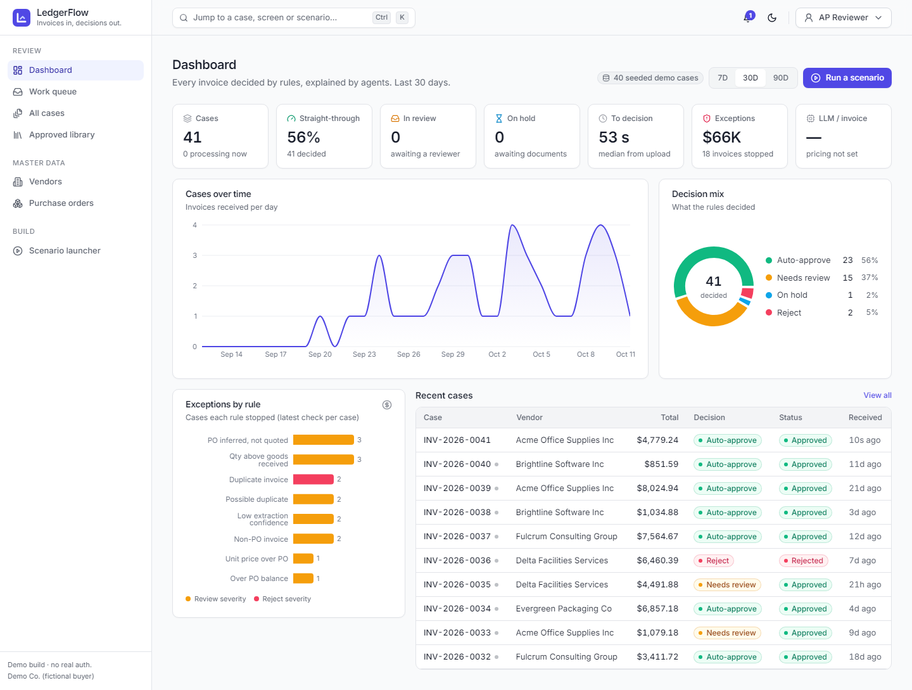
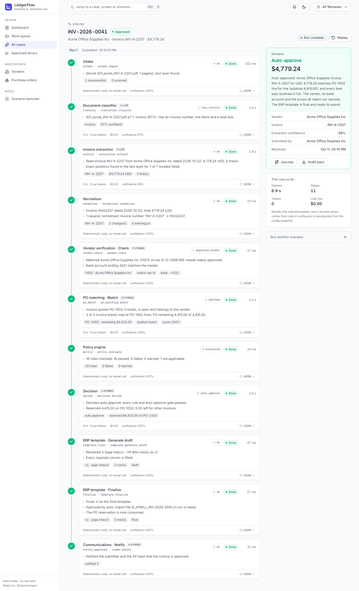
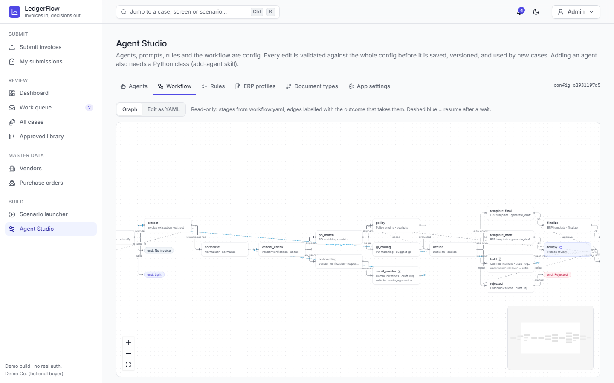

# LedgerFlow

**From PDF invoice to a reasoned AP decision, with the reasoning visible at every step.**

A vendor or employee submits invoices. Eleven configurable agents classify the documents, extract the fields, match them to purchase orders, apply procurement rules and return one of four decisions: **Auto-approve**, **Needs review**, **On hold** or **Reject**. A reviewer sees the source PDF beside the generated ERP template. They approve it, or type a remark in plain English that the Reconciler agent turns into exact changes and re-checks. Approved invoices are exported as ERP import files (Sage Intacct, QuickBooks Online or a generic Excel workbook).

> **The model gathers evidence. Rules make the decision.** LLM output never sets a decision, a rule status or an amount directly. Every money decision passes through deterministic rule and decision code.

Built for the Zamp case study PS-1 (*Invoice processing: from PDF to decision*). It also includes a light vendor-onboarding flow (PS-2) as one of the edge cases.

**New to the app?** The [User Guide](docs/USER_GUIDE.md) walks through every screen for submitters, reviewers, admins and vendors.

| Dashboard | Live run |
| --- | --- |
|  |  |
| **Review workspace** | **Agent Studio: workflow** |
|  |  |

---

## Contents
- [What it does](#what-it-does)
- [How it works](#how-it-works)
- [Edge cases covered](#edge-cases-covered)
- [Tech stack](#tech-stack)
- [Run it locally](#run-it-locally)
- [Configuration](#configuration)
- [Testing](#testing)
- [Deployment](#deployment)
- [Repository layout](#repository-layout)
- [Assumptions and scope](#assumptions-and-scope)

## What it does

- **Submit and track.** Drag-and-drop upload of PDFs, images or DOCX files. A courier-style journey tracker shows each case moving from Received to Exported, with the current status in plain English.
- **Watch the agents work live.** The live run view streams every stage over SSE. Each stage card shows the agent's reasoning, its key outputs, timing, tokens and cost. Finished runs can be replayed.
- **Review with evidence.** Highlights on the PDF line up with the extracted fields. The workspace also has an editable ERP grid (low-confidence or rule-flagged cells are marked), a rule checklist, invoice vs PO vs GRN line matching, and version history with diffs.
- **Correct by remark.** For example: *"PO was amended to $10,500, accept the premium support line and code it to 6410"*. The Reconciler turns that into typed operations, validates them in code, re-runs policy and decision, and presents template v2 with a diff.
- **Export safely.** The approved library offers per-invoice downloads, a ZIP of selected invoices, or one batch ERP import file. Re-exporting asks for confirmation to prevent double posting. Each case also has a PDF audit pack.
- **Master data.** Vendors come with verification checks and learned "vendor memory" hints. Purchase orders show reserved, consumed and remaining balances, so split invoices can't both pass.
- **Vendor portal.** Vendors get a no-login upload link for missing documents (W-9, bank letter). Outbound messages are drafts with a `mailto:` link. There is no email API.
- **Agent Studio.** Agents, prompts, rules, the workflow, document types and ERP profiles can be edited in the browser. Each edit is validated against the whole config before it is saved, and versioned with reset-to-file. Studio also offers a test-agent dry run and a workflow graph.
- **Scenario launcher and command palette** (Ctrl/Cmd+K) for one-click demos.

## How it works

```
[React SPA (Vercel)]  --REST + SSE-->  [FastAPI (Render)]
                                          |-- Orchestrator: deterministic state machine from config/workflow.yaml
                                          |-- Job runner: in-process asyncio queue, resumable after restart
                                          |-- 11 agents: each = Python class + YAML config + optional prompt
                                          |-- LLM adapter -> Azure OpenAI GPT-5.2 (Responses API, strict JSON schema, vision)
                                          |-- Storage -> local disk (dev) | Supabase Storage (prod)
                                          '-- Database -> SQLite (dev) | Supabase Postgres (prod)
```

**Design principles**
1. **The orchestrator is code, not an LLM.** It reads `workflow.yaml`, runs a stage, maps the outcome to the next stage, records an append-only `stage_event` and emits it over SSE.
2. **LLMs only perceive and explain.** They classify, extract, rank PO candidates, parse remarks and write explanations. Decisions come from `rules.yaml` and the decision code.
3. **Reproducible.** Every run snapshots the config it used (hash plus resolved YAML), so a decision can be explained after the config changes.
4. **Human in charge.** Once a person has touched a case, it can't auto-approve itself (`sticky_review`).

### The pipeline

| # | Agent | Kind | Role |
| --- | --- | --- | --- |
| 1 | intake | code | Store files, hash them, convert images and DOCX to PDF, render pages, detect scans |
| 2 | classifier | LLM | Label each document; split bundles that hold several invoices into child cases |
| 3 | extraction | LLM | Vision + text → strict invoice schema with per-field confidence and bounding boxes |
| 4 | normaliser | code | ISO dates, `Decimal` amounts, invoice-number normalisation, embedded tax split |
| 5 | vendor | hybrid | Match by tax ID, fuzzy name or email domain; check bank details; start onboarding |
| 6 | po_matching | hybrid | Validate the PO reference, or infer the PO from scored candidates; pair lines; suggest GL codes |
| 7 | policy | code | Run every enabled rule in `rules.yaml` |
| 8 | decision | hybrid | Code picks the decision from rule severities and auto-approve gates; the LLM only writes the explanation |
| 9 | template | code | Render the ERP profile rows, validate required columns, version them |
| 10 | reconciler | hybrid | Remark → typed `ChangeSet` → validated in code → re-run policy, decision and template |
| 11 | comms | hybrid | Draft vendor and submitter messages, `mailto:` links, portal upload links |

**18 policy rules** cover required fields, arithmetic, exact and near duplicates, vendor status, bank details, PO validity, price tolerance (% and absolute), quantity vs goods received, PO balance, unmatched lines, currency, date sanity and tax rates. On top of the rules, auto-approve requires every gate to pass: extraction confidence ≥ 0.90, total ≤ 25,000, an explicit PO and an approved vendor.

## Edge cases covered

Each scenario in `data/scenarios.yaml` has a generated PDF and an automated test that checks exact numbers.

| Scenario | Outcome | What it shows |
| --- | --- | --- |
| S01 happy path | Auto-approve | All rules pass; PO-1002 consumed 4,415.00 |
| S02a / S02b split invoice | Auto-approve, then Needs review | The second part exceeds the PO's remaining balance (+7.5% > 2%) and adds an unordered line; fixed by remark, then approved |
| S03 implied PO | Needs review | No PO number; proposes PO-1004 from scored candidates but never auto-approves a guess |
| S04 duplicate scan | Reject | Scanned copy of S01 caught after invoice-number normalisation |
| S05 unknown vendor | On hold | Onboarding request → vendor uploads documents via the portal → vendor approved → case resumes |
| S06 bank change | On hold | Bank details differ from the vendor master; explanation flags payment-fraud risk |
| S07 non-PO | Needs review | GL code suggested (6100 Facilities Maintenance); needs budget-owner approval |
| S08 price variance | Needs review | Unit price +4.8% and +$60 over the PO, beyond both tolerances |
| S09 missing fields | On hold | No invoice number or date; draft request lists what is missing |
| S10 bundle | Split into 2 cases | One PDF with two invoices, each decided on its own |

## Tech stack

| Layer | Tools |
| --- | --- |
| Backend | Python 3.12, FastAPI, Pydantic v2, SQLAlchemy 2, sse-starlette, OpenAI SDK (Azure), PyMuPDF, Pillow, rapidfuzz, sandboxed Jinja2, openpyxl, reportlab |
| Frontend | Vite, React 18, TypeScript, Tailwind, shadcn/ui, TanStack Query and Table, react-router, react-pdf, recharts, cmdk, sonner |
| Data | SQLite + local disk in development; Supabase Postgres + Storage in production |
| Hosting | Render (API), Vercel (SPA), Supabase (DB + files), all on free tiers |
| Tooling | uv, npm, ruff, pytest, GNU make |

## Run it locally

**Prerequisites:** Python 3.12, [uv](https://docs.astral.sh/uv/), Node 20+, GNU make. On Windows, the make from ezwinports works.

```bash
git clone https://github.com/BhuwanAwasthi/ledgerflow.git
cd ledgerflow
make setup                 # uv sync + npm ci
cp .env.example .env       # then fill in the values below
make seed                  # create the SQLite DB and load master data + demo history
make dev                   # API on http://localhost:8000, app on http://localhost:5173
```

On PowerShell, use `Copy-Item .env.example .env` instead of `cp`.

### Environment variables

| Variable | Purpose |
| --- | --- |
| `AZURE_OPENAI_ENDPOINT`, `AZURE_OPENAI_API_KEY`, `AZURE_OPENAI_DEPLOYMENT` | Azure OpenAI GPT-5.2 deployment |
| `LLM_BACKEND` | `azure` (default) or `fake`, which replays recorded outputs so you can run without an Azure key |
| `DATABASE_URL` | Defaults to SQLite; in production, the Supabase session-pooler URI (`postgresql+psycopg://...`) |
| `STORAGE_BACKEND` | `local` (default) or `supabase` |
| `SUPABASE_URL`, `SUPABASE_SERVICE_KEY` | Only with `STORAGE_BACKEND=supabase` |
| `CORS_ORIGINS`, `PUBLIC_APP_URL` | SPA origin(s) and the base URL used in portal links |
| `VITE_API_URL` | Frontend: API base URL, read at build time (`frontend/.env`) |

To check that your Azure deployment supports text, image input and strict JSON:
```bash
uv run python backend/scripts/smoke_azure.py
```

### Make targets

| Command | What it does |
| --- | --- |
| `make setup` | Install backend and frontend dependencies |
| `make dev` | Start the API and the Vite dev server together |
| `make seed` | Reset the database and load master data |
| `make fixtures` | Regenerate master CSVs and invoice PDFs from `data/scenarios.yaml` |
| `make test` | Backend tests with a fake LLM (no network, no cost) |
| `make test-live` | Tests marked `live`, which call Azure |
| `make check` | ruff + pytest + TypeScript typecheck + production build |
| `make smoke-deploy URL=...` | End-to-end check against a deployed API |

## Configuration

Everything that shapes behaviour lives in [`config/`](config/) and can be edited as files or in Agent Studio. An invalid config is rejected with a readable error and is never half-applied.

| File | Controls |
| --- | --- |
| `workflow.yaml` | Stage graph: agent + action per stage, outcome → next stage, human-in-the-loop and wait-for-event stages |
| `agents/*.yaml` | One file per agent: enabled flag, actions and outcomes, model and reasoning effort, params |
| `prompts/*.md` | LLM prompts referenced by agents |
| `rules.yaml` | Policy rules, severities, thresholds, plain-English explanation templates, auto-approve gates |
| `document_types.yaml` | Classifier labels and how each is routed |
| `erp_profiles/*.yaml` | ERP export columns: Sage Intacct, QuickBooks Online, generic Excel |
| `app.yaml` | Branding, feature flags, LLM pricing (for cost per invoice), limits |

**Adding an agent** needs three things: a class in `backend/app/agents/`, a `config/agents/<id>.yaml`, and a stage in `config/workflow.yaml`. The loader checks that every outcome is mapped and every stage is reachable.

## Testing

```bash
make test      # 180 backend tests, LLM mocked
make check     # lint + tests + frontend typecheck + build
```

Tests run with a `FakeLLM` that replays recorded outputs from `backend/tests/llm_fixtures/`. They cover every scenario above, rule boundaries, the orchestrator, concurrency on shared PO balances, the remark loop, exports and config validation. Only tests marked `@pytest.mark.live` call Azure.

## Deployment

The project runs on free tiers: Supabase (Postgres + private `documents` bucket), Render (API via [`render.yaml`](render.yaml)) and Vercel (SPA from `frontend/`). A cron-job.org ping keeps the Render service warm on demo days. The step-by-step runbook, including env vars and troubleshooting, is in [docs/DEPLOY.md](docs/DEPLOY.md).

## Repository layout

```
backend/     FastAPI app: orchestrator, agents, rules engine, LLM adapter, exports, API routers, tests
frontend/    Vite + React SPA
config/      workflow, agents, prompts, rules, document types, ERP profiles
data/        scenarios.yaml, generated master CSVs and invoice fixtures
docs/        USER_GUIDE.md, SPEC.md (product spec), DECISIONS.md (design decisions), DEPLOY.md, DEMO_SCRIPT.md, screenshots
render.yaml  Render blueprint for the API
```

## Assumptions and scope

- **No ERP posting.** The approved export file stands in for posting.
- **No real authentication.** A role switcher (Submitter, AP Reviewer, Admin) stands in for SSO.
- **No outbound email.** Messages are drafts with `mailto:` links plus a vendor upload portal.
- **Out of scope:** payments, multi-currency FX conversion (there is a currency-mismatch rule) and 3-way matching beyond GRN quantity checks.

Design choices made where the spec was silent are logged in [docs/DECISIONS.md](docs/DECISIONS.md). The full product spec is in [docs/SPEC.md](docs/SPEC.md).
