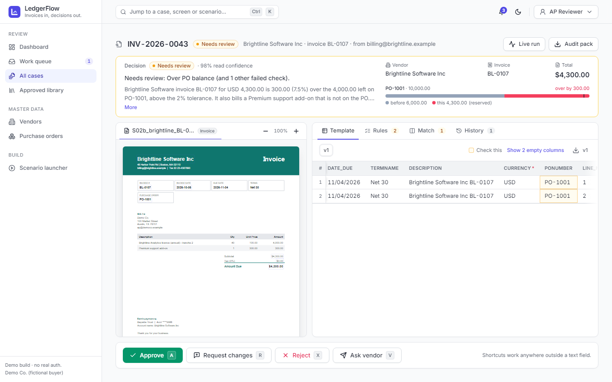

# LedgerFlow User Guide

**Invoices in, decisions out.**

This guide covers everyday use of LedgerFlow: submitting invoices, following their progress, reviewing and approving them, exporting them to your ERP, managing vendors and purchase orders, and changing how the engine behaves. It is written for the three kinds of people who use the app (submitters, AP reviewers and administrators) and for vendors who receive an upload link.

For installation, environment variables and deployment, see the [README](../README.md) and [DEPLOY.md](DEPLOY.md).

---

## Contents

1. [What LedgerFlow does](#1-what-ledgerflow-does)
2. [Getting started](#2-getting-started)
3. [Key concepts](#3-key-concepts)
4. [Submitters: send and track invoices](#4-submitters-send-and-track-invoices)
5. [Reviewers: the dashboard and work queue](#5-reviewers-the-dashboard-and-work-queue)
6. [Watching a case live](#6-watching-a-case-live)
7. [The review workspace](#7-the-review-workspace)
8. [Approved library and ERP export](#8-approved-library-and-erp-export)
9. [Vendors](#9-vendors)
10. [Purchase orders](#10-purchase-orders)
11. [Vendors: the upload portal](#11-vendors-the-upload-portal)
12. [Admins: Agent Studio](#12-admins-agent-studio)
13. [Scenario launcher and guided walkthroughs](#13-scenario-launcher-and-guided-walkthroughs)
14. [Reference](#14-reference)
15. [Troubleshooting and FAQ](#15-troubleshooting-and-faq)
16. [Glossary](#16-glossary)

---

## 1. What LedgerFlow does

LedgerFlow takes a supplier invoice (PDF, image or Word document) and turns it into an accounts-payable decision with the reasons spelled out:

| Decision | Meaning | What happens next |
| --- | --- | --- |
| **Auto-approve** | Every rule passed and every auto-approve gate was met | The ERP template is finalised and the invoice waits in the Approved library for export |
| **Needs review** | At least one rule needs a person's judgement | The case goes to the Work queue; a reviewer approves it, corrects it or rejects it |
| **On hold** | Information or documents are missing, or the vendor isn't verified | A request is drafted for the vendor or submitter, with a no-login upload link. The case resumes when the documents arrive |
| **Reject** | A blocking problem was found, such as an exact duplicate | The PO reservation is released and a rejection message is drafted |

Behind the scenes, eleven agents handle the invoice in turn. They read the document, extract the fields, find the vendor and the purchase order, and check the invoice against your procurement rules.

> **The model gathers evidence. Rules make the decision.** The AI reads documents and writes explanations. It never decides whether an invoice is paid, never sets a rule result and never changes an amount on its own. Decisions come from the rules in `config/rules.yaml`, which run as ordinary code. Two people looking at the same evidence and the same rules always get the same decision.

What LedgerFlow does **not** do (by design):
- It does not post to your ERP. It produces import files that you load yourself.
- It does not send email. Every outbound message is a draft you copy or open in your own mail app.
- It does not make payments or convert currencies.
- It has no real login. A role switcher stands in for sign-in (see [Roles](#22-roles)).

---

## 2. Getting started

### 2.1 Opening the app

Open the LedgerFlow URL in a modern browser (Chrome, Edge, Firefox or Safari). Locally this is `http://localhost:5173`.

If the hosted API has been idle, a violet banner reads **"Waking the engine…"**. The free API server sleeps after 15 minutes without traffic and takes about a minute to start. Wait for the banner to go away; the page refreshes its data on its own. If the banner turns amber (**"Can't reach the engine yet. Retrying…"**), the app keeps retrying every few seconds.

### 2.2 Roles

Use the role switcher at the top right to pick who you are. Your choice is remembered in this browser.

| Role | Can do | Home screen |
| --- | --- | --- |
| **Submitter** | Upload invoices, track their journey, run demo scenarios | My submissions |
| **AP Reviewer** | Everything in Review and Master data: dashboard, queue, review, approve, export, vendors, POs | Dashboard |
| **Admin** | Everything a reviewer can do, plus Agent Studio, submitting invoices, and retrying failed or paused runs | Dashboard |

> Roles are a demo convenience, not security. Anyone with the URL can switch roles. Your role label ("AP Reviewer" or "Admin") is recorded as the actor on review actions and exports.

### 2.3 Screen layout

- **Sidebar (left).** Screens grouped as *Submit*, *Review*, *Master data* and *Build*. Only the screens for your role are shown. The **Work queue** item shows how many cases are waiting.
- **Search bar (top).** "Jump to a case, screen or scenario…" opens the command palette.
- **Notification bell.** In-app notifications for your audience (submitters or the AP team). Click one to open its case.
- **Theme toggle.** Switches between light and dark mode.
- **Role switcher.** See above.

### 2.4 Command palette (Ctrl+K / Cmd+K)

Press **Ctrl+K** (Windows/Linux) or **Cmd+K** (Mac) anywhere to open the palette. Start typing to find:
- **Cases**, by reference (`INV-2026-0007`), vendor name, invoice number or submitter
- **Screens** you can access, plus *Toggle dark mode*
- **Run a scenario**, which starts a demo invoice and opens its live view

Use the arrow keys and **Enter** to choose, or **Esc** to close.

---

## 3. Key concepts

### 3.1 Case

Each upload becomes a **case** with a reference such as `INV-2026-0001`. A case holds the uploaded documents, the extracted invoice, rule results, the decision, ERP template versions, review actions and a full event history.

If one PDF contains **several invoices**, the parent case is marked **Split** and each invoice continues as its own child case.

### 3.2 Case statuses

Status colours mean the same thing on every screen:

| Status | Colour | Meaning |
| --- | --- | --- |
| Received / Processing | Violet | The agents are working on it |
| Needs review | Amber | Waiting for a reviewer |
| On hold | Sky blue | Waiting for documents or information |
| Approved | Emerald | Final; ready to export |
| Exported | Teal | Included in an ERP export file |
| Rejected | Rose | Closed without payment |
| Failed | Rose | Processing stopped at a stage (an admin can retry) |
| No invoice | Slate | Nothing in the upload was recognised as an invoice |
| Split | Indigo | A bundle that became several child cases |

### 3.3 The journey

Submitters see a courier-style tracker with these steps:

**Received → Classified → Extracted → Matched → Checked → Decided → In review → Approved → Exported**

Steps that a case doesn't need (for example *In review* for an auto-approved invoice) show as "Not needed". The headline above the tracker says where the case is in plain English, for example *"With the AP team for review"* or *"Waiting for a signed bank letter"*.

### 3.4 Rules and severities

Each policy rule returns **Pass**, **Warn** or **Fail**. A failing rule has a severity that sets how serious the failure is:

| Severity | Effect of a failure |
| --- | --- |
| **Reject** | The case is rejected |
| **Hold** | The case goes on hold |
| **Review** | The case needs review |
| **Info** | Shown only; never blocks auto-approve |

When several rules fail, the most serious one wins: **reject > hold > review**. The full list of rules is in [section 14.1](#141-policy-rules).

### 3.5 Auto-approve gates

An invoice is auto-approved only if **no rule failed and every gate passes**:

| Gate | Default |
| --- | --- |
| Every required field read with confidence of at least | 0.90 |
| Invoice total at most | 25,000 |
| PO number quoted on the invoice (an inferred PO never auto-approves) | required |
| Vendor approved in the vendor master | required |

If any gate fails, the invoice goes to review even when every rule passed.

### 3.6 PO balance: reserved, consumed, remaining

Each purchase order tracks how much has been used:
- **Reserved**: invoices currently in flight that have been decided as auto-approve or needs review
- **Consumed**: approved invoices
- **Remaining**: PO amount minus reserved and consumed

Reservation happens at the decision stage, so two halves of a split invoice processed at the same time cannot both use the same balance. Approving a case turns its reservation into consumption. Rejecting a case releases it.

### 3.7 ERP template versions

For any case that reaches review or approval, the Template agent renders the invoice into rows in your ERP's import format (v1). Each set of reviewer changes produces a new version (v2, v3…) with a cell-by-cell diff. On approval, the latest version is frozen as **final**.

### 3.8 Sticky review

Once a person has touched a case, it can't auto-approve itself. If a reviewer's correction makes every rule pass, the case still returns to review so that a human gives the final approval.

### 3.9 Reproducibility

Every case stores a snapshot of the configuration it ran with. If an admin later changes a rule, cases that had already started keep the old rules, and each past decision can still be explained exactly.

---

## 4. Submitters: send and track invoices

### 4.1 Submit invoices

Go to **Submit invoices** (Submitter or Admin role).

1. **Add files.** Drag files into the drop area or click it to browse. Accepted types are PDF, PNG, JPG and DOCX. Each file can be up to 15 MB, and up to 8 pages per document are read. You can include supporting documents (purchase order, delivery note) with the invoice. If a PDF holds several invoices, it is split automatically.
2. Remove any file you added by mistake with the bin icon.
3. Enter **Your name** and **Email**. Requests for missing documents are drafted to this address. Both are remembered for next time.
4. Optionally add a **Note for the AP team**, for example *"second part of the split PO-1001 delivery"*.
5. Click **Submit**.

A confirmation card shows your **case reference**. Keep it. From there you can:
- **Track the journey**: opens My submissions with this case highlighted
- **Watch it live**: opens the live run view
- **Submit another**

### 4.2 My submissions

**My submissions** shows a card for each invoice:
- Reference, status, vendor, invoice number, amount and when it was sent
- A plain-English headline of where it is now
- The journey tracker, with timestamps on completed steps
- **Live view**, which opens the stage-by-stage view

Type your email into **Filter by your email** to see only your submissions. With the box empty, the demo shows everyone's submissions. Cards refresh automatically while a case is processing.

### 4.3 When a case is on hold

If something is missing (a W-9, a bank letter, an invoice number), the card shows:
- What is needed, in the headline
- **Copy link** and **Open upload page**, which lead to a secure upload page that needs no login

Upload the requested documents there (see [section 11](#11-vendors-the-upload-portal)). The case resumes on its own once the AP team has what it needs.

---

## 5. Reviewers: the dashboard and work queue

### 5.1 Dashboard

The **Dashboard** gives an overview for a chosen range (**7d**, **30d** or **90d**; 30 days by default).

**KPI tiles**

| Tile | What it counts |
| --- | --- |
| Cases | Invoices received in the range (bundle parents excluded) |
| Straight-through | Share of cases auto-approved and closed without a person touching them |
| In review | Cases waiting in the work queue right now |
| On hold | Cases paused for documents or vendor onboarding right now |
| To decision | Median time from upload to decision |
| Exceptions | Total value of invoices that rules sent to review, hold or reject instead of paying |
| LLM / invoice | AI spend divided by cases (shows "—" until pricing is set in `app.yaml`) |

**Charts**
- **Cases over time**: invoices received per day
- **Decision mix**: what the rules decided
- **Exceptions by rule**: how many cases each rule stopped

**Recent cases** lists the latest cases; **View all** opens All cases. A "seeded demo history" badge means sample history was loaded (`make seed`) so the charts have data on first open.

### 5.2 Work queue

The **Work queue** lists every case in **Needs review** or **On hold**, with the oldest SLA deadline first. SLAs are 24 hours for review and 72 hours for on-hold cases. Each row shows the main reason in one line. Click a row:
- **Needs review** cases open the review workspace
- **On hold** cases open the live run view

"Queue is clear" means nothing is waiting.

### 5.3 All cases

**All cases** lists every invoice the engine has seen, with reference, vendor, invoice number, total, decision, status, current stage and created date. Tables support sorting, column filters and saved views, which are remembered per browser. Click a row to open the case.

---

## 6. Watching a case live

The **live run** view (`/cases/<id>/live`) streams each stage as it happens.

**Stage timeline.** Each agent's step appears as a card showing:
- The agent and action, and its kind: *LLM*, *Code* (deterministic, no model call) or *Hybrid (LLM + code)*
- A status chip: Running, Done, Failed, Skipped or Waiting
- Duration, and for model calls the tokens and cost (with a *cache hit* marker when a cached answer was reused)
- One to five plain-English **reasoning** lines
- **Key output chips**, for example `PO-1002 · remaining $4,000`, `3 line(s)` or `score 92%`
- A collapsible **JSON** panel with the stage's full output

Runs are grouped (*Run 1*, *Run 2*…) when a case restarts: after a reviewer remark, a vendor upload, or a retry.

**Special states**
- **Waiting for a reviewer**: the card says so and offers **Open review**.
- **Waiting for an event**: for example vendor documents. The run resumes on its own when the event arrives.
- **Failed**: the card shows the error. An **Admin** can click **Retry** to start a new run from the failed stage. Other roles see "Switch to Admin to retry".

**Side panel.** The decision (or "Pending…"), invoice details, extraction confidence, submitter, received time, elapsed time and total LLM cost. **Open review** goes to the workspace.

**Connection indicator.** Shows whether the event stream is live, reconnecting (it resumes from the last event received) or finished.

**Replay.** For a finished run, **Replay** re-animates the stored events with compressed timing, which is useful for demos. While it plays, the indicator reads *Replaying*.

---

## 7. The review workspace

Open a case in review from the Work queue, from **Open review** in the live view, or from a notification. The workspace is built to fit a 1280×720 screen, with the document, the template and the actions all visible at once.

### 7.1 Header

The case reference, status, vendor, invoice number and submitter, plus:
- **Live run**: the stage timeline
- **Audit pack**: a PDF with the decision report, rule results and every stage event
- **Compare duplicate / Review view**: shown when the case matches an earlier invoice (see 7.7)

### 7.2 Decision bar

- **Decision badge** and a short **explanation**. The first sentence is built by code from the rule results; the AI adds detail and the next step. Use **More** to expand it.
- **Confidence**: the lowest confidence among the required fields.
- **Vendor**, **invoice** and **total**.
- **PO** and a **PO balance mini-bar** comparing what was invoiced before, this invoice and what was left. Hover it for the numbers. A non-PO invoice says "No PO linked: coded to a GL account instead."
- **Callouts**: some failures (such as "Unsure this is an invoice") are shown as a prominent alert.

### 7.3 Left pane: the documents

- One tab per uploaded document, with zoom in and out.
- **Field highlights**: boxes show where each extracted value was read. Hover a box to highlight the matching cell in the template, or hover a cell to highlight its box. Amber boxes mark low-confidence or rule-flagged fields.
- Scanned PDFs (no text layer) are marked; their field locations come from the vision model and are approximate.

### 7.4 Right pane: four tabs

**Template.** The editable ERP grid, in your ERP profile's columns.
- Switch between versions (**v1**, **v2**…). The download button next to the version saves that version's file.
- **Amber cells ("Check this")** were read with low confidence (below 0.90) or flagged by a failed rule.
- **Indigo cells ("Changed since v1")** changed in this version. A strip above the grid lists every change: *row 2 GL_ACCOUNT 6400 → 6410*.
- **Click a cell to edit** it, where a field is editable (invoice fields, line amounts, quantities, prices, GL codes, departments). Edited cells show the old value in a tooltip. Edits are **not applied** until you send them with **Request changes**.
- Columns that are empty on every row are hidden behind **Show N empty columns**.

**Rules.** The pass/warn/fail checklist with each rule's plain-English explanation, for example: *"Invoice subtotal 4,300.00 vs PO PO-1001 remaining 4,000.00 (already invoiced 6,000.00 of 10,000.00): over by 7.5%, tolerance 2%."* Waived or info results are listed separately. The tab badge counts failures.

**Match.** Invoice lines beside PO lines and goods-received (GRN) quantities: invoice qty × price, PO qty × price, GRN, and a result per line (for example *Not on the PO* or *no GRN*). When the PO was inferred rather than quoted, **Candidate POs (ranked)** lists the scored candidates and marks the **Pre-linked** one.

**History.** Every template version with its diff, and the thread of review actions: approvals, remarks, rejections, vendor requests and overrides. If the Reconciler needs clarification, its question appears here.

### 7.5 Actions and keyboard shortcuts

The action bar at the bottom offers four actions. The shortcut keys work anywhere except while you are typing in a field or have a dialog open.

| Action | Key | What it does |
| --- | --- | --- |
| **Approve** | `A` | Asks for confirmation (Enter confirms), then finalises the latest template, turns the PO reservation into consumption and moves the case to the Approved library. Disabled while grid edits are unapplied. |
| **Request changes** | `R` | Opens the remark box. Write what should change in plain English and/or send your grid edits. `Ctrl+Enter` sends. |
| **Reject** | `X` | Requires a reason. Releases the PO reservation and drafts a rejection message to the submitter. |
| **Ask vendor** | `V` | Say what you need. The case goes on hold and the comms agent drafts a message with a no-login upload link. On a case that is already on hold, this button reads **Vendor request** and shows the existing draft. |

### 7.6 Correcting a case with a remark

This is the main way to fix an invoice that needs review.

1. Press **R** (or click **Request changes**).
2. Write the change in plain words, for example:
   > PO was amended to $10,500, accept the premium support line and code it to 6410
3. Click **Send to reconciler** (or press `Ctrl+Enter`).

What happens next:
- The **Reconciler** turns your words into exact, typed changes, such as *record a PO amendment to 10,500*, *set line 3's GL to 6410* and *waive "Lines not on the PO" with your reason*.
- Code checks every change. If any change is invalid, none is applied (all or nothing).
- Policy, decision and template run again. A banner shows progress, and **Watch live** opens the live view.
- When it finishes, a toast names the new version (for example *"Changes applied: template v2 is ready"*), and the grid shows the diff.
- Because of sticky review, the case comes back to you. Check v2, then **Approve**.

If your remark is ambiguous, **nothing is changed**. The Reconciler asks a question, shown in a toast and in the History tab. Answer with a new remark.

**Grid edits** go through the same validation but are applied exactly as typed, with no AI involved. Make your edits in the Template tab, press **R**, optionally add a note explaining why (it is kept in the audit trail), and send. To abandon edits, choose **Discard edits** in the Approve dialog.

What a remark can do:
- Change a field or line value
- Set a line's GL code and department
- Link or unlink a PO
- Waive (override) a rule, with a reason
- Record a PO amendment. It applies to this case at once; on approval it also becomes the PO's master amount, with an audit record.
- Teach the vendor memory a hint for future invoices from this vendor

What it can't do: change bank details. A bank change is accepted only through a verified bank letter from the vendor.

### 7.7 Duplicates

When a case is flagged as a duplicate of an earlier invoice, it opens in **compare view**: the rule's explanation, a field-by-field table with matching values highlighted, and both PDFs side by side. Use **Review view** to switch back. An exact duplicate is rejected automatically ("nothing will be paid twice").

### 7.8 Finished cases

When a case is closed, the action bar becomes one status line, for example *"Approved by AP Reviewer · 13 Oct 2026 10:42"*, with a link to the Approved library.

---

## 8. Approved library and ERP export

**Approved library** holds every approved invoice ready for your ERP.

### 8.1 Invoices tab

- Filter by **Not exported** (default), **Exported** or **All**.
- Choose the **ERP profile**: *Sage Intacct - AP Bills* (CSV), *QuickBooks Online - Bills* (CSV) or *Generic AP workbook (Excel)*.
- Select invoices with the checkboxes, or click a row. The selection bar shows the count and total.
- Each row also offers the case's ERP file, its **audit pack** and a link to open the case.

Two export actions:

| Button | Result |
| --- | --- |
| **Download selected (ZIP)** | A ZIP with one ERP file per invoice |
| **Export batch** | One ERP import file containing every selected invoice |

Both create an export batch (`EXP-0001`, `EXP-0002`…), download the file and mark the invoices **Exported**.

**Re-export protection.** If your selection includes already-exported invoices, an **Export again?** dialog lists them and warns that importing them twice would post the bill twice. Continue only if the earlier file was never imported.

### 8.2 Export history tab

Every export batch with its reference, profile, invoices, creator and date, with a download button to fetch the file again.

---

## 9. Vendors

**Vendors** is the vendor master: code, legal name, status, category, default GL and whether non-PO invoices are allowed. **Export CSV** downloads the master.

Vendor statuses: **Approved**, **Pending documents**, **Rejected**, **Inactive**.

Open a vendor to see:
- **Master data**: country, email domain, bank account (last 4 digits), category, default GL, non-PO policy, date added, and any aliases it invoices under.
- **Document requests**: each onboarding or information request, with **Copy upload link** and **Open portal**.
- **Documents and verification checks**, run in code on each upload:
  - name on the document vs the legal name
  - tax ID format
  - bank account
  - *Check by eye* for scans that can't be checked automatically
- **Invoices waiting** from this vendor.
- **Vendor memory**: hints learned from reviewer corrections and given to extraction on this vendor's next invoices.

**Approving a new vendor.** **Approve vendor** is shown for vendors with pending or newly received documents. It is enabled once the documents are in and no check has failed. Approving it resumes every case that was paused for onboarding. **Reject vendor** asks for a reason, keeps the vendor out of the master and closes its open requests.

---

## 10. Purchase orders

**Purchase orders** lists each PO with a bar showing **consumed · reserved · remaining**. **Export CSV** downloads the list.

Open a PO to see:
- PO amount, consumed, reserved and remaining
- PO lines: description, quantity, invoiced quantity, unit price, amount
- **Every invoice** that consumed or reserved part of it, with its state. Invoices split from a bundle are labelled with the bundle's reference.

---

## 11. Vendors: the upload portal

Vendors and submitters receive a link of the form `/portal/<token>` in a drafted message. The page needs **no login** and shows only what the vendor needs:

- A greeting and why the documents are needed ("Before we can pay your first invoice we need a few documents to set you up as a supplier.")
- **What we need**: the list of requested documents, ticked off as they arrive
- A drop zone for uploads (PDF, images or DOCX)
- After each upload, plain status lines such as *"Name matches our records"*, *"Bank account confirmed"* or *"We will check this document by hand"*
- What is still missing, or *"Everything we asked for is here. Our AP team will check it and get back to you."*

Once everything is in, the drop zone collapses behind **Send a corrected document**.

If the link shows **"This link is not valid"**, make sure the whole link was copied, or ask your AP contact for a new one.

---

## 12. Admins: Agent Studio

**Agent Studio** (Admin only) is where you change how LedgerFlow behaves without touching code. Every edit is checked against the **whole** configuration before it is saved. An invalid change is rejected with a readable error and never half-applied. Saved changes apply to **new** cases; cases already started keep their snapshot. The header shows the hash of the running config.

### 12.1 Tabs

| Tab | What you can do |
| --- | --- |
| **Agents** | The eleven agents in pipeline order, each with kind, run count, failures, average latency and cost. Turn an agent **on or off**; a disabled agent's stage is skipped. Edit the agent's YAML (model, reasoning effort, parameters) and its prompt. |
| **Workflow** | **Graph** view: stages and the outcomes that link them; dashed blue edges are resumes after a wait. **Edit as YAML** to change the stage graph. |
| **Rules** | **Table** view: enable or disable each rule and change its severity, applies-to and simple parameters (lists and maps are edited in YAML), plus the auto-approve gates. **Edit as YAML** for everything else, including the explanation text. |
| **ERP profiles** | Columns, header names and value expressions for each export format. |
| **Document types** | Classifier labels, their descriptions and how each is routed (invoice, evidence, onboarding, ignore). |
| **App settings** | Branding, feature flags, LLM pricing (for cost per invoice), limits, SLAs and UI text. |

### 12.2 Editing, saving and versions

- The editor validates as you type. Errors appear inline.
- **Validate and save** (`Ctrl+S`) stores a new version. A badge shows how many files have unsaved changes.
- **Versions** lists earlier Studio versions, newest first. Loading one puts it in the editor as an unsaved change.
- **Reset to file** switches back to the file in `config/`. Studio versions stay in history and can be loaded again.

### 12.3 Test agent (dry run)

Pick an **agent**, an **action** and a **case**, then run it. The agent runs against a throwaway copy of the data: nothing is saved and no case changes. The output shows the outcome, reasoning, rule results as chips, metrics and the raw JSON. Tick **Use unsaved edits** to try a change before you save it.

### 12.4 Example: loosen the price tolerance

1. Agent Studio → **Rules** → *Unit prices within tolerance* → set `pct` from 2 to 5 → **Validate and save**.
2. Reject the existing S08 case (otherwise the new run is rejected as an exact duplicate), then run **S08** again from the Scenario launcher. The +4.8% variance is now within tolerance, so the invoice auto-approves.
3. **Reset to file** restores the 2% tolerance.

### 12.5 Retrying a run

On the live run view, an Admin can **Retry** a failed stage. Retry starts a new run from that stage. It is allowed for failed, needs-review and on-hold cases. Approved, exported, rejected and split cases are final.

> Adding a completely new agent also needs a Python class in `backend/app/agents/`. See the `add-agent` skill and the [README](../README.md#configuration).

---

## 13. Scenario launcher and guided walkthroughs

**Scenario launcher** has one card per synthetic test invoice from `data/scenarios.yaml`, with the expected decision and a *scan* marker for scanned images. **Run** starts the scenario and opens its live view; the download icon saves the source file. Run the scenarios **in the order shown**, because later ones depend on PO balances the earlier ones use.

| # | Scenario | Expected outcome | What it shows |
| --- | --- | --- | --- |
| S01 | Clean PDF, exact 3-line PO match | Auto-approve | Every rule passes; PO-1002 consumes 4,415.00 |
| S02a | First of two invoices against one PO | Auto-approve | PO-1001 remaining drops from 10,000 to 4,000 |
| S02b | Second split invoice exceeds remaining balance and adds an unordered line | Needs review | Over PO balance (+7.5% vs 2% tolerance) and "Premium support" not on the PO; fixed by remark |
| S03 | No PO number, only a quote reference | Needs review | PO-1004 proposed from scored candidates, never auto-approved |
| S04 | S01 re-sent as a skewed scan with a reformatted number | Reject | Exact duplicate caught after normalising the invoice number |
| S05 | Vendor not in master, no PO | On hold | Onboarding through the vendor portal |
| S06 | Known vendor, new bank account on the invoice | On hold | Payment-fraud warning; signed bank letter requested |
| S07 | Legitimate non-PO service invoice | Needs review | GL 6100 Facilities Maintenance suggested; budget-owner approval |
| S08 | Unit price above PO beyond tolerance | Needs review | +4.8% and +$60 per unit, over both limits |
| S10 | One PDF with two invoices from different vendors | Split | Two child cases, each decided on its own |
| S09 | Poor scan with no invoice number or date | On hold | The request lists the missing fields |

### Walkthrough A: happy path (S01)
1. Run **S01** from the launcher.
2. Watch the stages complete: classified, extracted, matched to PO-1002 (3 of 3 lines), every rule passes → **Auto-approve**.
3. Open **Approved library** and download the Sage Intacct CSV.

### Walkthrough B: correct by remark (S02a then S02b)
1. Run **S02a**. It auto-approves and uses 6,000 of PO-1001.
2. Run **S02b**. It lands in **Needs review**.
3. Open the review workspace. The **Rules** tab shows *Over PO balance* and *Lines not on the PO*; the **Match** tab shows the unordered "Premium support" line.
4. Press **R** and send: *PO was amended to $10,500, accept the premium support line and code it to 6410*.
5. Template **v2** appears with its diff, and every rule passes. Press **A** to approve.

### Walkthrough C: new vendor onboarding (S05)
1. Run **S05**. The vendor is unknown, so the case goes **On hold**.
2. In the live view or the review workspace, open the drafted message and the upload link.
3. Open the portal and upload the W-9 and the bank letter.
4. In **Vendors**, open the new vendor, review the verification checks and click **Approve vendor**.
5. The paused case resumes on its own and continues through matching and policy.

---

## 14. Reference

### 14.1 Policy rules

Applies to: *all* invoices, *PO* invoices only, or *non-PO* invoices only. Defaults are from `config/rules.yaml` and can be changed in Agent Studio.

| Rule | Applies to | Severity | Fails when |
| --- | --- | --- | --- |
| Required fields present | all | Hold | Invoice number, date, total or vendor name is missing |
| Document recognised as an invoice | all | Review | The classifier was below its confidence threshold (0.70) |
| Extraction confidence | all | Review | A field was read with confidence below 0.60 |
| Lines, tax and total add up | all | Review | Lines + tax + shipping differ from the total by more than 0.05 |
| Not a duplicate | all | **Reject** | Same vendor, normalised invoice number and amount as an earlier case |
| Not a possible duplicate | all | Review | Same vendor and amount within 30 days, different invoice number |
| Vendor is approved | all | Hold | The vendor is pending, inactive or rejected |
| Bank details match vendor master | all | Hold | The invoice's bank account differs from the master (fraud risk) |
| PO exists, is open and belongs to vendor | PO | Review | The PO is unknown, closed or another vendor's |
| PO was inferred, not quoted | PO | Review | No PO number on the invoice; the best match was inferred |
| Unit prices within tolerance | PO | Review | A unit price exceeds the PO by more than 2% **and** more than $50 |
| Quantity not above goods received | PO | Review | Invoiced quantity is above the GRN quantity |
| Within remaining PO balance | PO | Review | Subtotal exceeds the PO's remaining balance by more than 2% |
| All lines map to the PO | PO | Review | A line isn't on the PO |
| Non-PO invoice needs budget-owner approval | non-PO | Review | Always, for non-PO invoices (a GL code is suggested) |
| Currency matches PO | PO | Review | Invoice and PO currencies differ |
| Invoice date is plausible | all | Review | More than 3 days in the future or more than 365 days old |
| Tax rate is an allowed rate | all | Review | The rate isn't one of 0, 5, 6.25, 7.25, 8.25, 10 or 20% |

### 14.2 The agents

| # | Agent | Kind | Role |
| --- | --- | --- | --- |
| 1 | Intake | Code | Stores files, converts images and DOCX to PDF, renders pages, detects scans |
| 2 | Classifier | LLM | Labels each document; splits bundles into child cases |
| 3 | Extraction | LLM | Reads the invoice fields with per-field confidence and locations |
| 4 | Normaliser | Code | Standardises dates, amounts, invoice numbers and embedded tax |
| 5 | Vendor | Hybrid | Matches the vendor by tax ID, name or email domain; checks bank details; starts onboarding |
| 6 | PO matching | Hybrid | Validates or infers the PO; pairs lines; suggests GL codes for non-PO invoices |
| 7 | Policy | Code | Runs every enabled rule |
| 8 | Decision | Hybrid | Code picks the decision; the AI only writes the explanation |
| 9 | Template | Code | Renders and versions the ERP rows; finalises on approval |
| 10 | Reconciler | Hybrid | Turns a reviewer remark into validated changes |
| 11 | Comms | Hybrid | Drafts messages, `mailto:` links, portal links and notifications |

### 14.3 Document types

| Label | Handling |
| --- | --- |
| Invoice, Credit note | Processed as an invoice case |
| Purchase order, Delivery note | Attached as evidence for matching and review |
| Tax form (W-9, W-8BEN), Bank letter | Used for vendor onboarding |
| Statement, Other | Stored and shown, not processed |

### 14.4 Keyboard shortcuts

| Keys | Where | Action |
| --- | --- | --- |
| `Ctrl+K` / `Cmd+K` | Anywhere | Open the command palette |
| `A` | Review workspace | Approve (with confirmation) |
| `R` | Review workspace | Request changes |
| `X` | Review workspace | Reject |
| `V` | Review workspace | Ask vendor / view vendor request |
| `Ctrl+Enter` | Remark box | Send to reconciler |
| `Ctrl+S` | Agent Studio editor | Validate and save |
| `Esc` | Dialogs and palette | Close |

### 14.5 Limits and defaults

| Setting | Default |
| --- | --- |
| Max upload size | 15 MB per file |
| Pages read per document | 8 |
| Accepted file types | PDF, PNG, JPG, DOCX |
| SLA: needs review / on hold | 24 h / 72 h |
| Auto-approve ceiling | 25,000 |
| Case references | `INV-2026-0001`… |
| Export batch references | `EXP-0001`… |

All of these are set in `config/app.yaml` and `config/rules.yaml`.

---

## 15. Troubleshooting and FAQ

**The app shows "Waking the engine…" for a long time.**
The free API host sleeps after 15 minutes idle; the first request can take about a minute. If it lasts longer than two minutes, check the API's `/healthz` URL directly.

**My invoice went to review although everything looks right.**
Check the **Rules** tab first. If every rule passed, an auto-approve gate stopped it: a field read below 0.90 confidence, a total over 25,000, an inferred PO or a non-approved vendor. The decision bar names the reason.

**I can't click Approve.**
You have unapplied grid edits. Send them with **Request changes** (R), or discard them. Approve is also unavailable while the case is re-running.

**My remark didn't change anything.**
The Reconciler found it ambiguous or invalid and asked a question instead. Check the **History** tab and send a clearer remark. Changes are all or nothing.

**I corrected everything, but the case came back to review.**
That is sticky review: once a person has touched a case, a person approves it. Check the new version and press **A**.

**A scenario was rejected as a duplicate.**
You ran it a second time. Each scenario uses fixed invoice numbers, so a second run matches the first. Reset the demo data with `make seed`, or reject the earlier case before rerunning (see 12.4).

**The keyboard shortcuts do nothing.**
They are ignored while you're typing in a field or a dialog is open. Click on an empty part of the page first.

**"Fixture not generated: run make fixtures" on a scenario card.**
The scenario's PDF hasn't been generated. Run `make fixtures`.

**LLM cost shows "—".**
Pricing isn't set. Fill in `llm.pricing_per_1m_usd` in **App settings**.

**No email was sent to the vendor.**
That's expected. LedgerFlow never sends email. Use **Copy message**, **Open in mail app** or **Copy upload link** on the draft.

**How do I reset the demo?**
Run `make seed`. It resets the database and reloads master data and demo history.

---

## 16. Glossary

| Term | Meaning |
| --- | --- |
| **AP** | Accounts payable: the team that checks and pays supplier invoices |
| **Audit pack** | A PDF per case with the decision report, rule results and every stage event |
| **Case** | One invoice moving through LedgerFlow, with all its documents and history |
| **Consumed / Reserved / Remaining** | How much of a PO approved invoices have used, in-flight invoices are holding, and is still available |
| **Decision** | Auto-approve, Needs review, On hold or Reject |
| **ERP profile** | The column layout of an import file for an ERP (Sage Intacct, QuickBooks Online, generic Excel) |
| **Export batch** | One export action (`EXP-0001`), with its file and the invoices it included |
| **GL code** | General-ledger account an invoice line is booked to (for example 6410 Software Support) |
| **GRN** | Goods received note: proof of how many items were delivered |
| **HITL** | Human in the loop: the review step |
| **Implied PO** | A PO inferred from scored candidates when the invoice didn't quote one |
| **Non-PO invoice** | An invoice with no purchase order; it needs a GL code and budget-owner approval |
| **PO** | Purchase order: what the buyer agreed to buy, at what price |
| **Reconciler** | The agent that turns a reviewer's remark into exact, validated changes |
| **Remark** | A plain-English correction a reviewer writes in the review workspace |
| **Sticky review** | The rule that a case a person has touched must also be approved by a person |
| **Stage event** | The record of one agent step: start, finish, reasoning, outputs and metrics |
| **Straight-through** | An invoice approved and closed without any human touch |
| **Vendor memory** | Hints learned from reviewer corrections, used when reading that vendor's next invoices |
| **Vendor portal** | The no-login upload page for requested documents |
